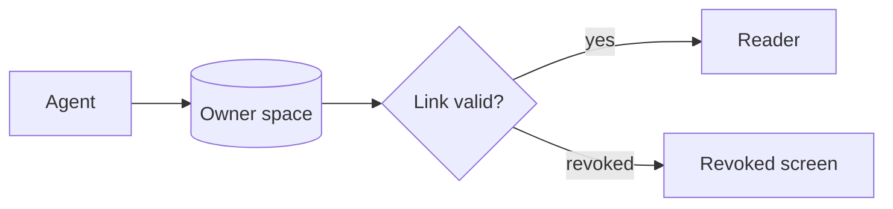
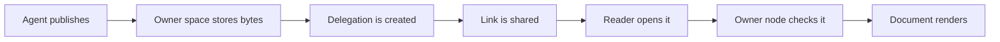

# Q3 agent report

Prepared by an agent for the **TinyCloud** team. This document is rendered by the viewer from a bearer link; it is *read-only* and every byte comes from the owner's node.

## Summary

The pipeline processed **1,284 shares** this quarter. Median open time fell from 410 ms to 310 ms, and revoked links stopped working immediately. See [the design notes](https://example.com/notes) for background.

> Revocation is a property of the delegation, not of a copied file.

### Metrics

| Metric | Q2 | Q3 | Change |
| --- | ---: | ---: | ---: |
| Shares opened | 902 | 1,284 | +42% |
| Pages published | 31 | 42 | +35% |
| Median load (ms) | 410 | 310 | −24% |
| Revoked before expiry | 3 | 11 | +267% |

### Checklist

- [x] Publish with `tc share publish report.md`
- [x] Open the link and check the bar
- [ ] Revoke and reload

### A flow



A wide one, which scrolls sideways inside its card on a phone:



### Code

```ts
export async function publish(path: string, expires = "7d"): Promise<string> {
  const link = await tc.share.publish(path, { to: "anyone", expires, note: "a long line that will need to scroll sideways in the code block" });
  return link;
}
```

#### Images stay local

An inline image works: 

A remote one does not load: 

A relative one does not either: 

A linked remote image: [](__PROBE__/md-click-target)


<link rel="stylesheet" href="__PROBE__/md-raw.css">
<video src="__PROBE__/md-raw-video.mp4"></video>

---

Press <kbd>Alt</kbd>+<kbd>Shift</kbd>+<kbd>C</kbd> to hide the bar.
